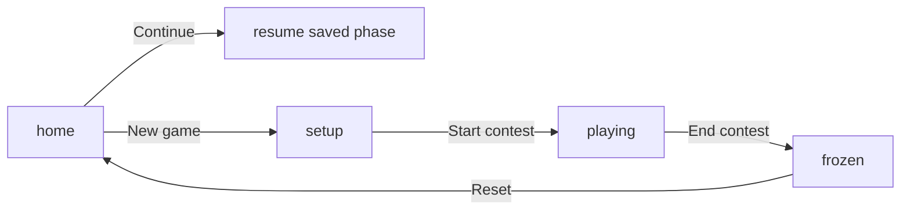

<!-- 03c313cc-8380-4f94-a9d1-d656d198aac4 -->
---
todos:
  - id: "lib-phases"
    content: "Add setGroupCount/renameGroup/startContest; gate member/points by phase; startHue null until N"
    status: pending
  - id: "views-flow"
    content: "Home / setup / play views; Start contest lock; remove custom pts; reset→home"
    status: pending
  - id: "board-layout"
    content: "Two-row centered board; fix card overflow; neon high-contrast theme"
    status: pending
  - id: "tests-flow"
    content: "Update unit/UI/e2e for new phases and layout"
    status: pending
isProject: false
---
# Contest Board flow + projection redesign

## Decisions (locked)

- **A:** Explicit **Start contest** leaves setup and locks the roster; play is score-only (`+1 −1`, End contest).
- **During play:** no add/remove users, no rename, no add/remove groups, no custom points field.
- **Colors:** assigned only after group count `N` is chosen (chromatic wheel, equal hue steps, random `startHue` at that moment).
- **Home first:** every open shows Continue / New game (Continue disabled if nothing saved).

## Phases

Extend `state.phase` in [`src/lib.js`](src/lib.js): `"setup" | "playing" | "frozen"`. Home is UI-only (no persisted phase): boot always mounts the home screen; Continue loads `contestBoard:current` and jumps to its phase UI.

## Setup screen

1. Choose **N** (2–10). Calling new lib helper `setGroupCount(state, n, rng)`:
   - draws/`keeps` `startHue`
   - replaces `state.groups` with `N` groups, each `name` prefilled from the wheel color name (editable)
   - clears members/points when `N` changes (simple + correct)
2. Show `N` name fields (neon swatch + text input). Renames write `group.name`.
3. **Add user** (name + Add): same anti-starving `addMember` as today.
4. Member lists visible under each group on this screen; remove member **allowed only in setup**.
5. **Start contest** enabled when `N >= 2` and at least one member exists; sets `phase: "playing"`, persists, shows play board.

## Play board

- Topbar: brand + status + **End contest** only (no add-group/user, no custom pts).
- Cards: name, neon rail/glow from group color, big score, `±` buttons; member names read-only (no �, big score, `±` buttons; member names read-only (no ✕).
- Fix overflow: clamp/truncate long names (`text-overflow: ellipsis`), constrain card height with scrollable member list if needed, larger projector type without spilling.
- Layout: Maximum three colunms per row, each row a centered flex/grid (e.g. 6 → 3+3, 5 → 3+2, 4 → 2+2, 3 → 2+1, 2 → 1+1). Implement in [`src/app.js`](src/app.js) + CSS (two `.board-row` containers), not `auto-fit` alone.

## Home + session lifecycle

- Home: **Continue last session** / **Start fresh gameplay**.
- Continue: deserialize current; if missing/corrupt → toast and stay home.
- Fresh: `newState()`, clear current key (or overwrite), enter setup with no groups until `N` picked; history untouched.
- Winner **Reset**: archive as today, then return to **home** (not an empty board).
- Past plays: keep on home or below setup; hide during play for a cleaner projector view.

## Visual direction (projection / neon)

Retheme [`src/styles.css`](src/styles.css) for high contrast TV-contest energy:

- Near-black stage background, bright neon accents (cyan / magenta / lime / hot amber) — not muted green dashboard.
- Group color = high-sat HSL from wheel + glow (`box-shadow` / border) on cards.
- Big display type for scores and brand; avoid low-contrast dim text on the board.

Bump `colorFor` saturation/lightness slightly if needed (e.g. `hsl(h, 90%, 60%)`) so projected colors stay vivid; keep equal hue spacing.

## Lib / API changes ([`src/lib.js`](src/lib.js))

- Add `setGroupCount(state, n, rng?)`, `renameGroup(state, id, name)`, `startContest(state)` (guards: 2–6 groups, ≥1 member total → `playing`).
- `addMember` / `removeMember` rejected when `phase !== "setup"`.
- `addPoints` only when `phase === "playing"`.
- `addGroup` / `removeGroup`: unused by UI after this; keep for tests or retire callers — prefer route setup only through `setGroupCount`.
- `newState`: `phase: "setup"`, `groups: []`, `startHue` can stay `null` until first `setGroupCount`.
- Persistence unchanged keys; deserialize older `"setup"` with groups still opens via Continue.

## UI structure ([`index.html`](index.html) + [`src/app.js`](src/app.js))

Three view roots toggled by `hidden`:

- `#view-home`
- `#view-setup`
- `#view-play` (board rows + end contest; winner overlay stays global)

Remove custom-points markup from card template. Setup uses its own group editors + shared add-user control. Keep incremental card patching on the play board (no full-board flash).

## Tests

Update [`src/lib.test.js`](src/lib.test.js) / [`src/app.test.js`](src/app.test.js) / e2e for:

- home Continue / Fresh
- `setGroupCount` colors/names; rename; members only in setup
- Start contest lock; points only in playing; no member remove in playing
- End → archive → home
- Board row counts for N = 2..10 (unit or DOM assert on `.board-row` children)

## Out of scope

- Multi-device sync, auth, changing `N` after Start contest, restoring custom-points.
